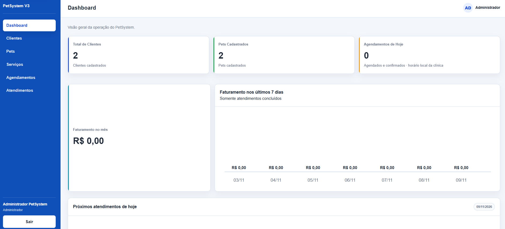
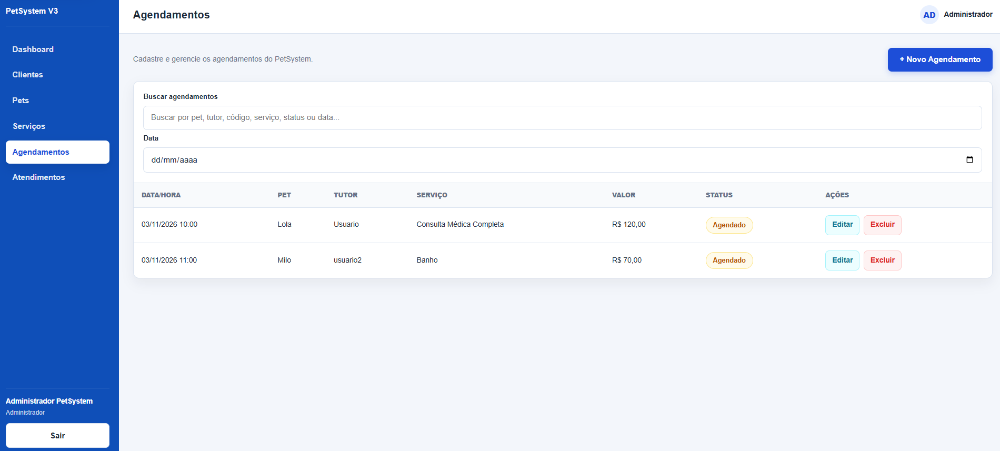
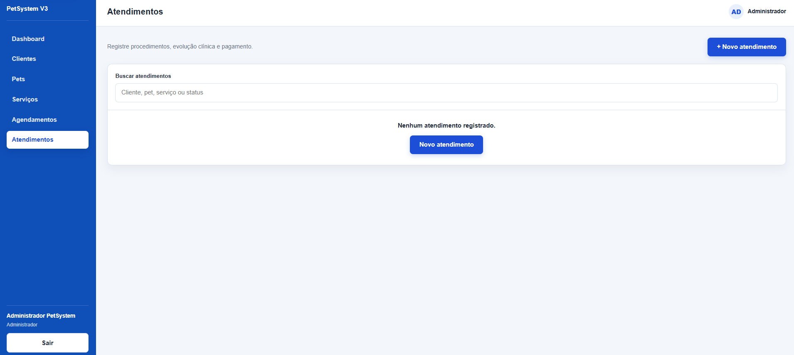
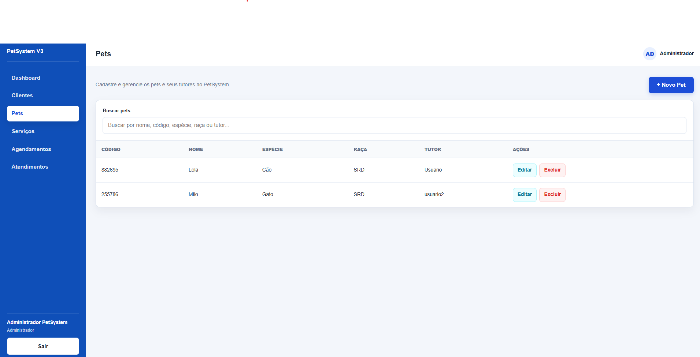
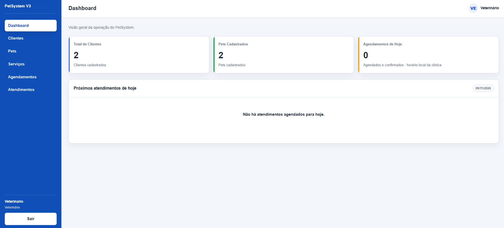

# PetSystem V3

Nos exemplos, substitua C:\caminho\Petsystemv3 pelo caminho da sua cópia do projeto.

Sistema web desenvolvido como projeto freelancer para apoiar a operação de um pet shop e clínica veterinária: cadastros de clientes e pets, serviços, agendamentos e atendimentos, com acesso separado para administração, recepção e veterinários.

## Evolução do projeto

O PetSystem V3 dá continuidade ao PetSystem V2. Esta versão reúne a aplicação atual em uma API Laravel e uma interface React, com autenticação por sessão, autorização no backend e ambiente demonstrativo com SQLite. O repositório apresenta o escopo implementado e suas evidências de validação; a homologação final permanece em andamento.

## Tecnologias

| Camada | Tecnologias |
| --- | --- |
| Backend | PHP 8.2+, Laravel 12, Laravel Sanctum 4 |
| Frontend | React 18, React Router 6, Vite 6, Axios |
| Demonstração local | SQLite |
| Testes | PHPUnit 11 e `node:test` |

## Funcionalidades

- Login e logout por sessão, proteção CSRF e bloqueio de usuários inativos.
- Clientes e pets com ficha, histórico e código público de seis dígitos para cada pet.
- Serviços com preço, duração e ativação/desativação pelo administrador.
- Agendamentos com confirmação, cancelamento e reagendamento com motivo; verificação de sobreposição de horários para o mesmo pet.
- Atendimentos avulsos ou iniciados a partir de agendamentos confirmados, evolução clínica, conclusão e registro de valor e forma de pagamento.
- Dashboard com contagens, próximos agendamentos do dia, faturamento mensal e gráfico dos últimos sete dias, considerando atendimentos concluídos.
- Busca, filtros e paginação local nas telas pertinentes, validações e estados de carregamento, erro e lista vazia.
- Navegação lateral responsiva, com opções textuais, indicação da seção ativa e foco por teclado.

O pagamento é um registro interno: não há processamento bancário, integração com adquirentes ou emissão fiscal. O faturamento soma valores de atendimentos concluídos, sem conciliação de recebimentos.

## Perfis de acesso

As permissões são aplicadas pela API, além dos controles da interface.

| Operação | Administrador (`admin`) | Recepção (`receptionist`) | Veterinário (`veterinarian`) |
| --- | --- | --- | --- |
| Consultar, criar e editar clientes e pets | Sim | Sim | Sim |
| Excluir clientes/pets sem vínculos impeditivos | Sim | Sim | Não |
| Consultar serviços | Sim | Sim | Sim, sem preço |
| Criar, editar e excluir/desativar serviços | Sim | Não | Não |
| Consultar, criar e editar agendamentos | Sim | Sim | Sim |
| Excluir agendamentos | Sim | Não | Não |
| Consultar e iniciar atendimentos | Sim | Sim | Sim |
| Editar evolução clínica e concluir atendimento | Sim | Não | Sim |
| Registrar valores e pagamento; consultar faturamento | Sim | Sim | Não |
| Excluir atendimentos | Não | Não | Não |

A API remove campos financeiros das respostas do veterinário e a evolução clínica das respostas da recepção, inclusive em históricos aninhados. A ficha básica do pet, alergias e alertas operacionais são compartilhados pelos três perfis. A conclusão pelo veterinário exige evolução clínica; o administrador pode concluir sem essa exigência na regra atual. Atendimentos são registros permanentes.

## Capturas de tela

Capturas reais da interface fornecidas pelo proprietário, revisadas visualmente para publicação. Os exemplos exibem nomes genéricos; não foram identificados contatos pessoais, credenciais ou dados clínicos sensíveis. As imagens foram preservadas sem edição visual. Veja o [índice das capturas](docs/img/README.md) para o conteúdo de cada tela e os limites dessa evidência.

### Dashboard

Indicadores operacionais e área financeira do perfil administrador.



### Agendamentos

Busca, filtro de data e listagem de agendamentos de exemplo.



### Atendimentos

Tela de atendimentos no estado de lista vazia, com acesso ao cadastro.



### Pets

Listagem de pets com código público, espécie, raça e tutor.



### Perfil veterinário

Dashboard do veterinário, com indicadores operacionais e sem a área financeira.



## Instalação e configuração local

Requisitos: Windows com CMD, Git, PHP 8.2+ com as extensões exigidas pelo Composer e `pdo_sqlite`, Composer 2, Node.js e npm. O ambiente foi validado com Node 24. Os scripts locais esperam PHP em `C:\xampp\php\php.exe` e Node/npm no PATH.

Instale as dependências dos lockfiles, a partir desta cópia do projeto:

```bat
cd /d C:\caminho\Petsystemv3\backend
composer install
composer check-platform-reqs
cd ..\frontend
npm.cmd ci
```

Em uma instalação nova, copie [backend/.env.demo.example](backend/.env.demo.example) para `backend/.env.demo`. Ajuste `DB_DATABASE` para o caminho absoluto de `backend/database/petsystem_demo.sqlite` **da sua cópia** e gere uma chave apenas se `APP_KEY` estiver vazia. Mantenha `APP_ENV=demo`, `DB_CONNECTION=sqlite` e `DB_URL` vazio. O `.env.demo` é privado e não acompanha o Git.

Siga o [guia de configuração](docs/setup.md) para preparar um banco novo ou verificar um existente. Preserve bancos e chaves já existentes; faça [backup](docs/backup.md) antes de atualizar uma demonstração com dados importantes. Não use `composer setup`, `migrate:fresh` ou seeders sobre o banco persistente existente.

### Inicialização em dois terminais CMD

Com dependências, ambiente e banco já preparados, abra o terminal 1 para o Laravel:

```bat
cd /d C:\caminho\Petsystemv3\backend
C:\xampp\php\php.exe artisan --env=demo serve --host=127.0.0.1 --port=8000
```

No terminal 2, inicie o React/Vite:

```bat
cd /d C:\caminho\Petsystemv3\frontend
set "PATH=C:\Program Files\nodejs;%PATH%"
npm.cmd run dev -- --host 127.0.0.1 --port 5173 --strictPort
```

Acesse `http://127.0.0.1:5173`; a API padrão fica em `http://127.0.0.1:8000/api`. Use o mesmo hostname durante a sessão. O caminho de Node acima corresponde à instalação validada; ajuste se necessário.

O atalho `scripts\iniciar.bat` pode preparar um SQLite novo com dados fictícios e iniciar os servidores. Em banco existente, ele pode aplicar migrations pendentes; consulte o guia e faça backup antes de atualizar. Reutilize servidores da mesma cópia e ambiente. Para encerrar os iniciados manualmente, pressione Ctrl+C nos respectivos terminais.

Crie somente as contas necessárias com `scripts\criar-usuario.bat`, informando o perfil e digitando a senha no terminal. Não há senha padrão. O `.env` original e o banco histórico MySQL/MariaDB não são necessários à demonstração.

## Testes e build

Na raiz, a verificação integrada protege o banco demo e usa SQLite em memória nos testes PHP:

```bat
set "PATH=C:\Program Files\nodejs;%PATH%"
scripts\verificar.bat
```

Para executar apenas os testes frontend e o build de produção:

```bat
cd /d C:\caminho\Petsystemv3\frontend
set "PATH=C:\Program Files\nodejs;%PATH%"
node.exe --test
npm.cmd run build
```

`npm.cmd run verify` também executa os testes frontend seguidos do build. Os artefatos ficam em `frontend/dist`, ignorado pelo Git. Resultados e limites da validação estão no [relatório de homologação](docs/homologacao.md). O [checklist manual](docs/checklist-manual.md) cobre o aceite funcional por perfil.

## Documentação e manutenção

- [Instalação, ambiente demo e diagnóstico de inicialização](docs/setup.md).
- [Backup e restauração do SQLite](docs/backup.md).
- [Checklist de homologação manual](docs/checklist-manual.md).
- [Resultados e pendências de homologação](docs/homologacao.md).
- [Auditoria de dependências e pendências de segurança](docs/seguranca-dependencias.md).

Os scripts versionados atendem à inicialização, parada identificada dos servidores, criação interativa de usuários, inspeção somente leitura do demo e verificação do projeto. Não publique arquivos `.env`, SQLite, logs, backups, senhas ou dados reais do cliente.

## Limitações conhecidas

- A demonstração local não equivale a produção homologada. Hospedagem, HTTPS, cookies seguros, debug desabilitado, infraestrutura e restauração real de backup exigem validação própria.
- Listagens com paginação local não foram homologadas para grandes volumes ou alta concorrência.
- A agenda verifica conflitos por pet; agenda por profissional, notificações e gestão de funcionários pela interface ficam para uma versão futura.
- A auditoria registrada em 08/11/2026 mantém uma pendência moderada do React Router, descrita no documento de segurança. Não se presume que o build resolva essa pendência.
- Capturas de tela demonstram a interface, mas não substituem os testes de autorização da API nem o aceite funcional completo.

A release `v1.0.0` depende da homologação final e do aceite do proprietário. Este repositório não declara implantação ou prontidão de produção.

[LinkedIn — Natan Da Luz](https://www.linkedin.com/in/natandaluz/)
